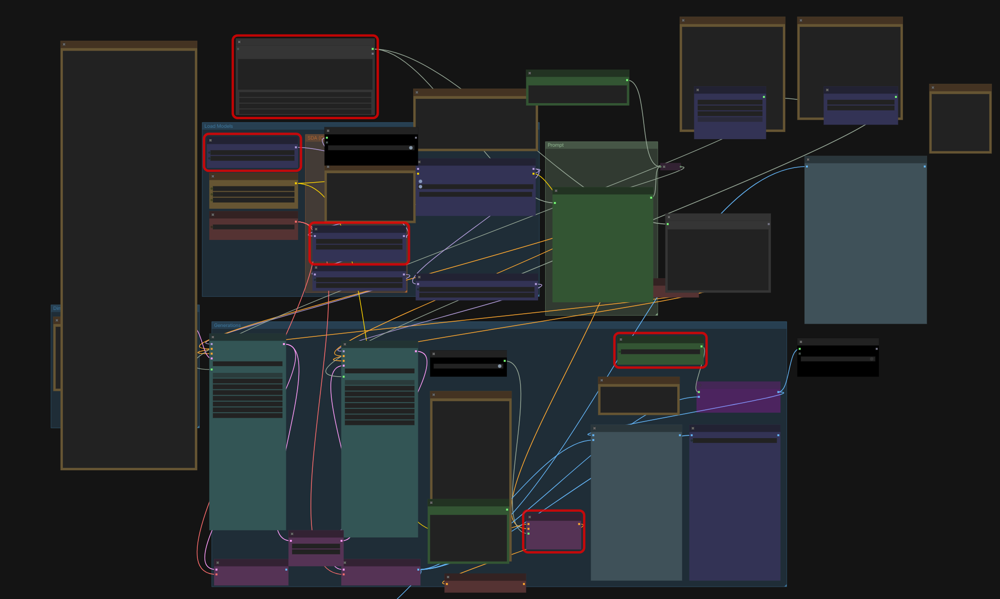
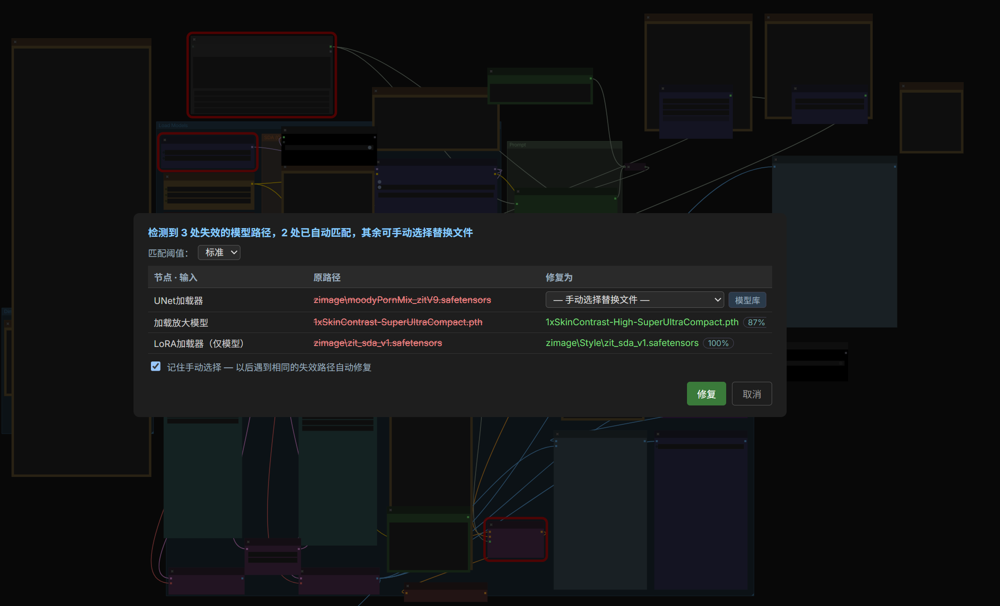

# Workflow Repair

> 🇨🇳 中文: [../workflow-repair.md](../workflow-repair.md)

Model paths inside a workflow (checkpoint / LoRA file names and the rest) go stale after a machine
move or a folder rename. The backend `workflow.py` only replaces a path when it finds a
**high-confidence match** in the model folders: post the workflow to `POST /neo_nodes/repair` and get
back one entry per change (old path → new path, plus the candidate files for everything that did not
match).

## 🅝 menu → "🔧 Repair Workflow"

One click checks and repairs the **current canvas** workflow:

- When stale paths are found a confirmation dialog opens: old path struck through in red → candidate
  new path in green, with the match confidence in percent. Clicking "Repair" updates the canvas in
  place (node positions preserved).
- The dialog offers **three match thresholds** (strict / standard / loose); low-confidence changes in
  the loose tier come pre-unchecked and are applied only after you confirm.
- Items auto-matching failed can be **picked by hand** in the "Repair to" column.
- When the model is **not installed at all** (the model folder is empty, no local candidate), a manual
  pick is pointless: the stale row offers a **📥 Model Hub** button with the landing category
  preselected from the input name (e.g. `clip_name` → `text_encoders`) and the file name prefilled as
  the search query, jumping straight into a Model Hub search.
- When the endpoint is unavailable a warning is shown and the canvas is left untouched; when nothing is
  stale you get a "check complete" notice.

## Repair mappings

- Tick "Remember manual picks" in the dialog and each manual "stale path → replacement file" is stored
  server-side (`user/neo_repair_mappings.json`). Later loads that hit the same stale path (case,
  extension and separator differences count as the same) are replaced automatically, with no repeated
  picking.
- Open the saved mappings from the 🅝 menu's "🔧 Repair Workflow" context menu, or from "Repair
  mappings" inside the "📜 Repair log" dialog, where you can also delete them.

## Automatic check on load

Loading a workflow from the gallery lightbox ("⤷ Import workflow") or a recipe ("📋 Copy workflow")
runs the same check. When stale paths are found, the 🅝 menu button lights up with a red dot, and the
"🔧 Repair Workflow" entry carries a red dot once the menu is open; click it to confirm the repair.

## 🅝 menu → "📜 Repair log"

Every repair you confirmed (canvas / gallery / recipe — the three sources) is written to a local log
(browser localStorage, up to 50 runs) and shown as a table, one row per change: time · source ·
node / input · old path · result (unmatched rows show the candidates). One click clears it.
Records stay on this machine and are never uploaded.

Backend implementation: [architecture.md](architecture.md) (`workflow.py`). API: [api-routes.md](api-routes.md).
