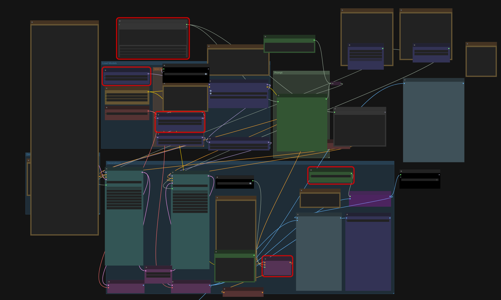
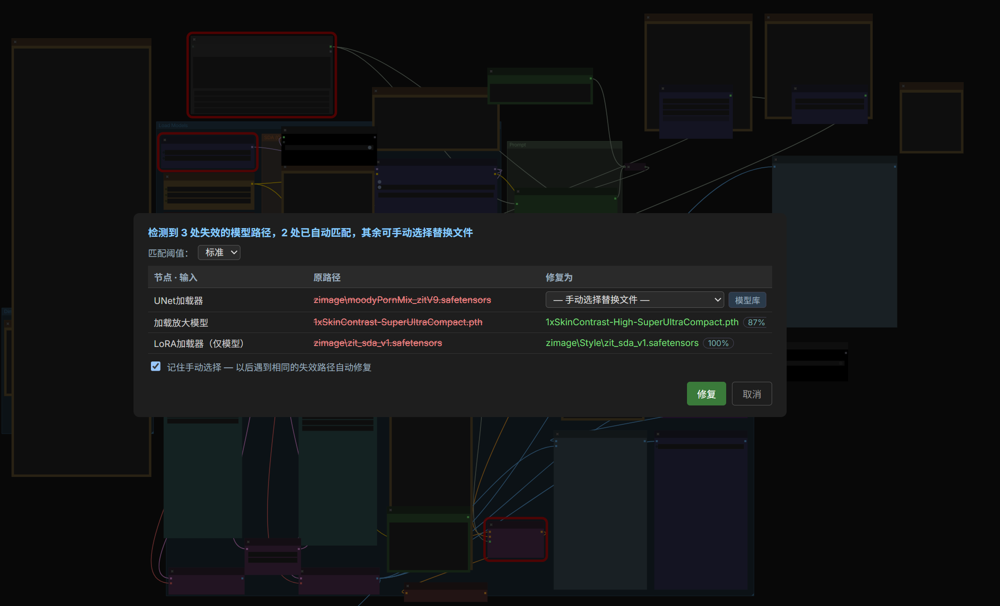

# 工作流修复

工作流中的模型路径（checkpoint / LoRA 文件名等）在换机器、改目录后会失效。
后端 `workflow.py` 只在模型目录中找到**高置信度匹配**时才替换：把工作流发给 `POST /neo_nodes/repair`，
返回每处修改的明细（原路径 → 新路径、未匹配项的候选文件列表）。

## 🅝 菜单「🔧 修复工作流」

对**当前画布**工作流一键检查并修复：

- 检测到失效路径时弹出确认框：原路径红色删除线 → 候选新路径绿色，附匹配置信度百分比，点「修复」后画布原地更新
  （节点位置保留）。
- 弹窗内可选**匹配阈值三档**（严格 / 标准 / 宽松）；宽松档的低置信改动默认不勾选，确认后才应用。
- 自动匹配失败的项可在「修复为」列**手动选择替换文件**。
- 模型**压根没装**时（模型目录为空，本地无任何候选）手动选择无从谈起：失效行会给出
  **📥 模型库**按钮，按输入名预选落盘类别（如 `clip_name` → `text_encoders`）、按文件名预填搜索词，
  直接跳到模型库搜索下载。
- 接口不可用时给出警告且画布保持原样；无失效路径时提示「检查完成」。

## 修复映射

- 确认框中勾选「记住手动选择」后，手动选择的「失效路径 → 替换文件」会保存到服务端
  （`user/neo_repair_mappings.json`），之后载入遇到相同失效路径（大小写 / 扩展名 / 分隔符差异视为相同）时
  自动替换，不再重复选择。
- 右键 🅝 菜单「🔧 修复工作流」项，或在「修复记录」弹窗中点「修复映射」，即可查看与删除已保存的映射。

## 载入前自动检查

从素材灯箱「⤷ 导入工作流」或配方「📋 复制工作流」载入后同样自动检测，
发现失效路径时顶栏 🅝 菜单按钮亮起红点提示，打开菜单时「🔧 修复工作流」条目右侧带红点引导，点击后确认修复。

## 🅝 菜单「📜 修复记录」

所有确认过的修复（画布 / 素材库 / 配方三个来源）都会写入本地日志（浏览器 localStorage，最多 50 次），
以表格展示每处修改点：时间 · 来源 · 节点 / 输入 · 原路径 · 修复结果（未匹配项显示候选），可一键清空。
记录仅存于本机，不上传。

后端实现见 [architecture.md](architecture.md)（`workflow.py`），API 见 [api-routes.md](api-routes.md)。
